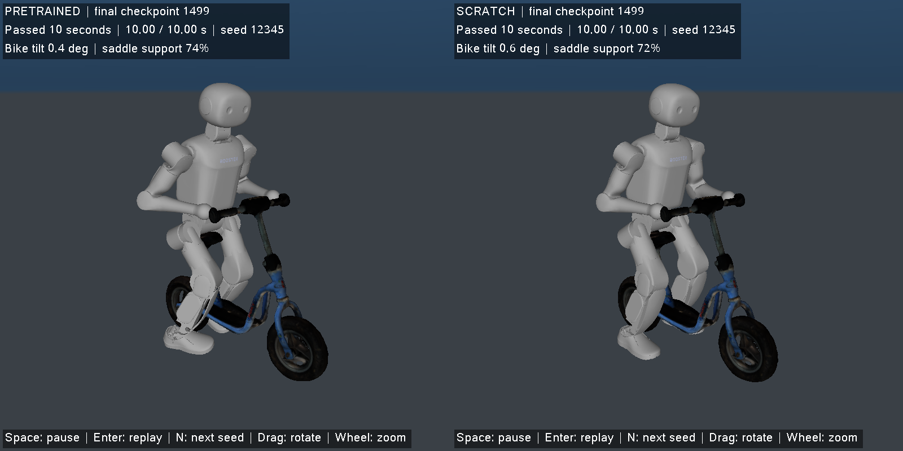

# Free-bike comparison artifacts

Comparison `free-bike-20261117T211126Z`: [run 1, pretrained](../run1/notes.md) and
[run 2, scratch](../run2/notes.md), trained on Hex with 1,500 new PPO updates each.

[Watch/download the synchronized comparison video](comparison-final.mp4).
The pretrained policy is on the left and scratch is on the right. This is a local
10-second playback with matched seed and pushes, not a recording of training on Hex.

[](comparison-final.mp4)

| Held-out evaluation | Pretrained | Scratch |
|---|---:|---:|
| Successful 10-second episodes | 32/32 | 32/32 |
| Bike or torso failures | 0 | 0 |
| Mean return | 49.8744 | 54.3205 |

W&B histories: [pretrained](https://forge.coreweave.com/wandb/K1Booster/laai-k1/runs/6tu6vq9j)
and [scratch](https://forge.coreweave.com/wandb/K1Booster/laai-k1/runs/63cnaaev).
Both reach this evaluation's survival ceiling; these are two training runs with one
shared training seed, not evidence of a statistically significant initialization advantage.

## Included files

Each `run1/` or `run2/` folder contains:

| Path | Contents |
|---|---|
| `training/events.out.tfevents.*` | Complete TensorBoard scalar history: 1,500 iterations and 43 scalar tags, including the final evaluation |
| `training/slurm-54645.out.gz` or `slurm-54646.out.gz` | Full SLURM console output, compressed without changing its contents |
| `training/laai-booster-k1-proj.diff.gz` | Git diff recorded by the training job |
| `params/` | Original environment, PPO and initialization configuration |
| `evaluation.json` | Final deterministic 32-episode evaluation, seed 12345 |
| `training_summary.json` | Training means over the last 50 logged iterations; these differ from evaluation returns |
| `actor_checkpoint.pt` | All original actor tensors, normalization and distribution, iteration 1499; optimizer and critic omitted |
| `policy.pt` | Verified TorchScript export in Booster's observation/action layout |

The compact actor checkpoints preserve every actor tensor from the original final
checkpoints. Their metadata records the original checkpoint hashes. They support
playback and actor initialization; full-state training resume requires the original
`model_1499.pt` on Hex.

This shared folder contains the video, preview image, original submission
[manifest](manifest.json), [source archive](source.tar.gz), and an
[artifact inventory with SHA-256 hashes](artifacts.json). The source archive and job
diffs preserve the submitted working-tree code; the manifest's Git revision alone
does not describe the uncommitted source used for training.

The video is 10 seconds, 25 FPS, 1600 x 800. Both exported policies matched checkpoint
actions exactly in the local CPU export check. No robot deployment is claimed.

## Replay locally

**Linux host**, repository root, with the training dependencies installed:

```bash
uv run --group train python scripts/compare_sit_free.py \
  --pretrained experiments/sit_free/runs/run1/actor_checkpoint.pt \
  --scratch experiments/sit_free/runs/run2/actor_checkpoint.pt
```

Space pauses/resumes, Enter replays both, N changes the shared seed, and Escape closes.
For the optional Linux GTK workaround, see [the command reference](../../../../docs/commands.md#linux-desktop-gtkwayland-workaround).

**Linux and macOS**, repository root: verify the binary artifacts against the inventory:

```bash
uv run python - <<'PY'
import hashlib, json
from pathlib import Path
root = Path("experiments/sit_free/runs")
manifest = json.loads((root / "comparison/artifacts.json").read_text())
for entry in manifest["files"]:
    data = (root / entry["path"]).read_bytes()
    assert len(data) == entry["size_bytes"], entry["path"]
    assert hashlib.sha256(data).hexdigest() == entry["sha256"], entry["path"]
print("All artifact hashes match")
PY
```
